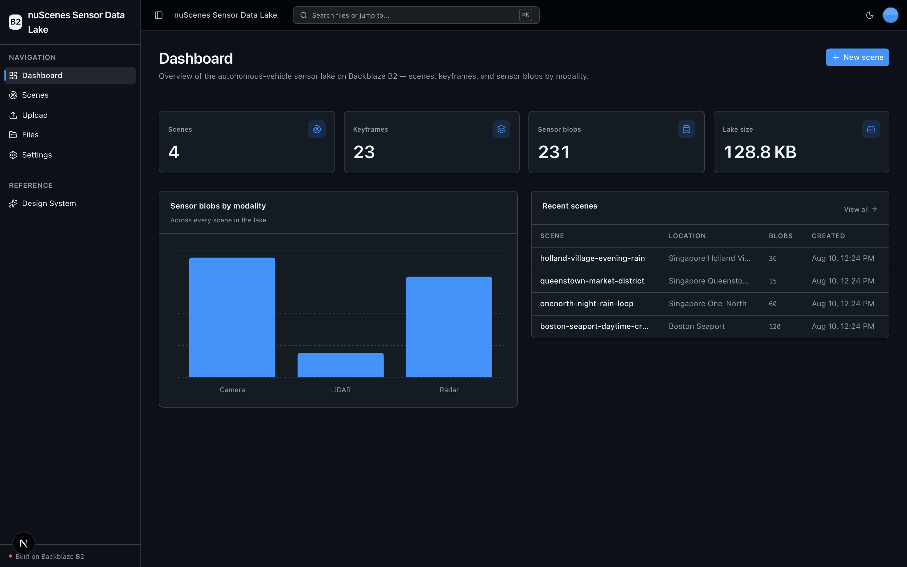
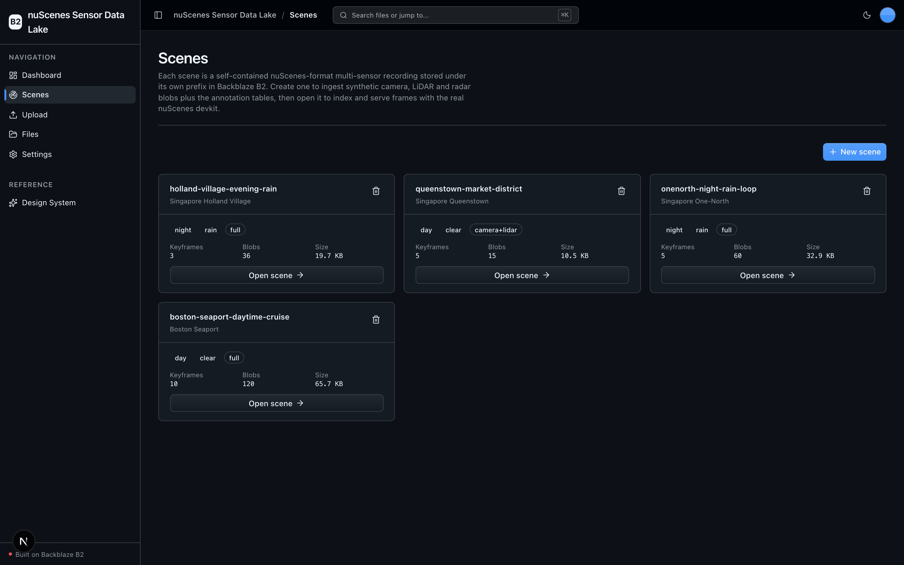
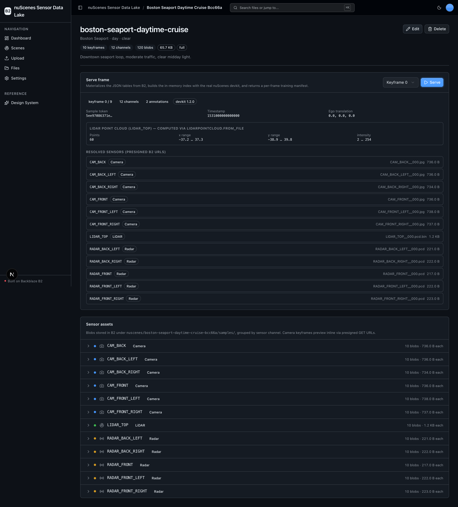
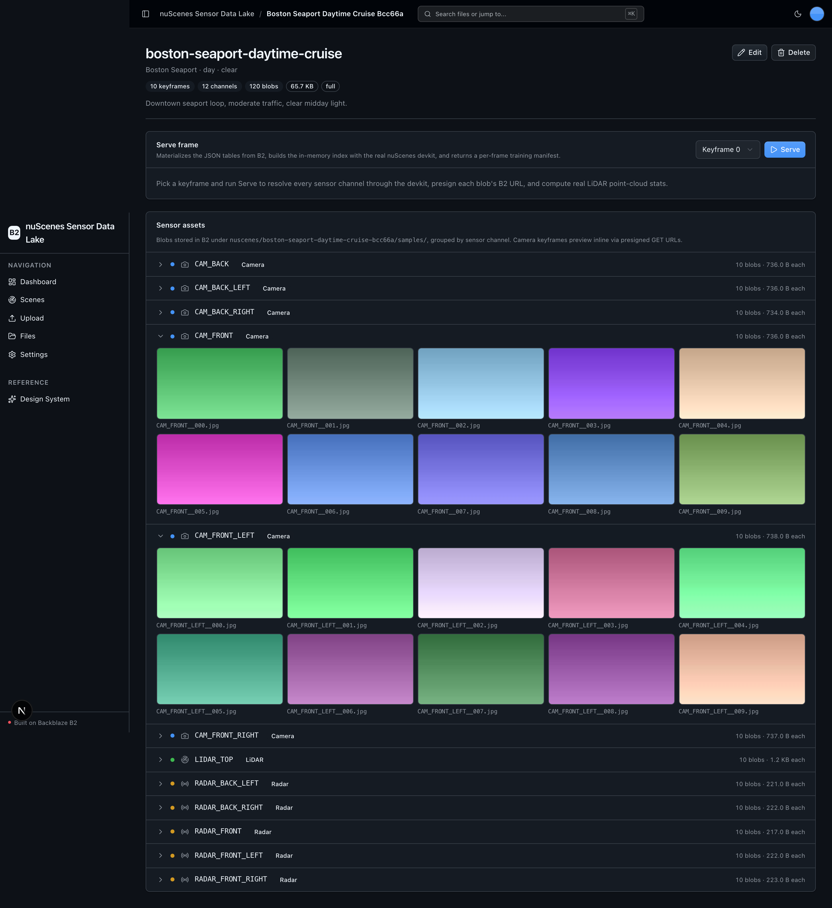

<!-- last_verified: 2026-08-10 -->
# nuScenes Sensor Data Lake

Use **[Backblaze B2](https://www.backblaze.com/sign-up/ai-cloud-storage?utm_source=github&utm_medium=referral&utm_campaign=ai_artifacts&utm_content=b2ai-nuscenes-sensor-data-lake)** as the S3-compatible **data lake for an autonomous-vehicle multi-sensor dataset**, driven by the real [nuScenes devkit](https://github.com/nutonomy/nuscenes-devkit). AV / robotics teams building 3D-perception models keep terabyte-scale multi-modal recordings — 360° camera images, LiDAR point-cloud sweeps, radar sweeps — plus the nuScenes-format annotation tables in B2, and stream frames on demand into training instead of co-locating the whole dataset on a training node.

The primary entity is a **Scene**. The app demonstrates the full loop end-to-end: **Ingest** synthetic nuScenes-format sensor blobs + annotation JSON to B2 → **Annotate** (the JSON tables that complete the schema) → **Index** (materialize the small tables locally and let the *actual* `nuscenes.nuscenes.NuScenes` devkit build its in-memory scene graph) → **Serve/Query** (resolve a keyframe's sensors through the devkit, presign B2 URLs, and return a per-frame training manifest with **real** point-cloud stats from `LidarPointCloud.from_file`). Backblaze B2 credentials only — no second API key, all local OSS.

> **How B2 fits (honest framing).** B2 is the system of record for every sensor blob and annotation table. The devkit needs a local `dataroot`, so **Index materializes only the small JSON annotation tables** (and the map masks the devkit opens) locally to build the in-memory index; **the sensor blobs stay in B2** and are fetched on demand — a presigned GET for previews/serving, or a pull to a temp file only when computing real LiDAR point-cloud stats. That is the "stream from a B2 lake without co-locating the dataset" story; the multi-GB blobs never have to live on the training node.

**What you get out of the box:**
- **Scenes** — create a referentially-valid nuScenes scene, ingest its camera / LiDAR / radar blobs + annotation tables to B2, index it with the real devkit, and serve any keyframe as a training manifest.
- **Scene-scoped sensor asset explorer** — browse a scene's blobs grouped by sensor channel, preview camera keyframes inline (presigned), and inspect LiDAR/radar blobs.
- **AV-lake dashboard** — scenes, keyframes, blobs-by-modality chart, recent scenes.
- Kept from the starter: a full-bucket File Explorer, generic drag-and-drop Upload, the shadcn/ui kit, and a FastAPI backend with strict layered architecture, structural tests, and agent-optimized docs.

## What it looks like

**Dashboard** — AV-lake totals (scenes, keyframes, sensor blobs, lake size), a blobs-by-modality chart, and the most recent scenes.



**Scenes** — every nuScenes scene as a card showing its capture location, conditions, keyframe / blob counts, and size, ready to open.



**Scene detail** — the served keyframe's training manifest with real LiDAR point-cloud stats (computed via the devkit) and presigned B2 URLs for every sensor channel.



**Sensor asset explorer** — a scene's blobs grouped by sensor channel, with camera keyframes previewed inline straight from presigned B2 GET URLs.



## Quick Start

You need: Node.js >= 20, pnpm >= 9, Python >= 3.12, and a free **[Backblaze B2 account](https://www.backblaze.com/sign-up/ai-cloud-storage?utm_source=github&utm_medium=referral&utm_campaign=ai_artifacts&utm_content=b2ai-nuscenes-sensor-data-lake)**.

### Supported local environments

Local scripts are supported on macOS, Linux, and WSL2. Native Windows is not
supported yet because the dev scripts use POSIX shell syntax and
`services/api/.venv/bin/*` paths; use WSL2 on Windows.

Cloud or sandboxed coding-agent environments also need permission for dependency
downloads during `pnpm run setup`. Running the app or Playwright E2E requires
localhost server binding for the web server on port 3000 and the API on
8000-8009, plus permission to launch the Playwright Chromium browser. If a
sandbox denies binding, `pnpm run doctor` and `scripts/pick-port.mjs` report
`EPERM`/`EACCES` as a permissions issue instead of a busy port. A host without
IPv6 (many containers) is not treated as a failure — the IPv4 probe decides.

### Start a new project

**Option 1: GitHub Template (recommended)**

Click the green **"Use this template"** button at the top of this repo, name your project, then:

```bash
git clone https://github.com/yourorg/my-cool-app.git
cd my-cool-app
```

**Option 2: Clone and reinitialize**

```bash
git clone https://github.com/backblaze-b2-samples/nuscenes-sensor-data-lake.git my-cool-app
cd my-cool-app
rm -rf .git
git init
git add .
git commit -m "Initial commit from nuscenes-sensor-data-lake"
```

Either way you get a clean project with no upstream history — ready to push to your own repo and point your agent at it.

### Setup

**1. Run setup**

```bash
pnpm run setup
```

This copies `.env.example` to `.env` only when `.env` does not already exist,
installs workspace dependencies from `pnpm-lock.yaml`, creates
`services/api/.venv` if missing, validates that an existing venv uses Python
3.12+, and installs the API's committed Python 3.12 resolution from
`services/api/requirements.lock`. It is safe to rerun and never overwrites an
existing `.env`.

> Use the `pnpm run` form: `setup` (like `doctor`) is a built-in pnpm command
> before pnpm 11, so bare `pnpm setup` would run pnpm's own command instead of
> this script.

**2. Add your B2 credentials**

Open `.env` in your editor and keep it visible. Then head to the [Backblaze B2 dashboard](https://secure.backblaze.com/b2_buckets.htm?utm_source=github&utm_medium=referral&utm_campaign=ai_artifacts&utm_content=b2ai-nuscenes-sensor-data-lake) and:

1. **Create a bucket.** B2 will show two values — paste each into `.env`:
   - **Bucket Unique Name** → `B2_BUCKET_NAME`
   - **Region** (the middle segment of the S3 Endpoint `s3.<region>.backblazeb2.com`, e.g. `us-west-004`) → `B2_REGION` *(the app derives the S3 endpoint from it)*
2. **Create an application key** with `Read and Write` permission. B2 will show two values — paste each into `.env`:
   - **keyID** → `B2_APPLICATION_KEY_ID`
   - **applicationKey** → `B2_APPLICATION_KEY` *(only shown once — paste it now)*

> Want a walkthrough? See the docs for [creating a bucket](https://www.backblaze.com/docs/cloud-storage-create-and-manage-buckets?utm_source=github&utm_medium=referral&utm_campaign=ai_artifacts&utm_content=b2ai-nuscenes-sensor-data-lake) and [creating app keys](https://www.backblaze.com/docs/cloud-storage-create-and-manage-app-keys?utm_source=github&utm_medium=referral&utm_campaign=ai_artifacts&utm_content=b2ai-nuscenes-sensor-data-lake).

**3. Run it**

```bash
pnpm dev
```

That's it. Frontend at `localhost:3000`, API at `localhost:8000`. Open **Scenes**, create one with the defaults, then open it and click **Serve** to index it with the devkit. Interactive API docs (Swagger UI) are at `localhost:8000/docs`, with ReDoc at `/redoc`.

`pnpm dev` runs the preflight check first — it catches the common setup gotchas (wrong Node/Python version, missing venv, missing or placeholder `.env`, ports already taken) and tells you exactly how to fix each one. Run it standalone any time with `pnpm run doctor`.

## When to use

Use this sample when you want a concrete, working example of **Backblaze B2 as
the S3-compatible data lake for a multi-sensor AV / robotics dataset** in the
nuScenes format. It is a good starting point when you want to see how to keep
camera / LiDAR / radar blobs and nuScenes annotation tables in B2, index them
with the real devkit without co-locating the whole dataset, and stream
per-keyframe sensor URLs into a training pipeline — with production-minded
engineering controls (strict architecture, contract checks, tests, linting,
deployment runbooks) instead of a blank prototype.

## When not to use

Do not choose this repository expecting a complete hosted SaaS product, a
production data platform, or the full nuScenes dataset. It ships **synthetic**
nuScenes-format scenes (tiny, deterministic blobs) so it runs for free with no
license or download; swap in real captures for real work. It does not provide
managed hosting, user accounts, authentication, tenant isolation, billing, or
on-call operations. Before using an adapted application in production, you own
its product-specific security, operations, capacity, compliance, and support
decisions.

## Building Your App

When you adapt this kit for a new app, keep the shared scaffolding and only swap out what's app-specific:

- **Keep** the UI kit (`apps/web/src/components/ui/` + design tokens in `globals.css` + `/design`).
- **Keep** the File Explorer (`/files`) and Upload (`/upload`) pages and their sidebar nav entries — they're the reusable B2-backed surface.
- **Adapt** the Dashboard (`/`) to your use case — replace the default stats, chart, and recent uploads with metrics that reflect what your app actually does.
- **Rebrand** by editing a single file: `apps/web/src/lib/app-config.ts` holds the app name and description (`APP_NAME`, `APP_DESCRIPTION`). Changing them there updates the page title, sidebar, and breadcrumb everywhere — no other files to touch.

Full contract and rationale: [AGENTS.md §2 — Building on This Starter Kit](AGENTS.md#2-building-on-this-starter-kit).

## Agent-First Architecture

This repo is optimized for coding agents. Use the template, point your agent at it, and start building.

The structure follows the principle that **repository knowledge is the system of record**. Anything an agent can't access in-context doesn't exist — so everything it needs to reason about the codebase is versioned, co-located, and discoverable from the repo itself.

### How it works

**[AGENTS.md](AGENTS.md) is the single source of truth for all coding agents.** Its bounded, agent-sized entry point gives agents the repository layout, architectural invariants, commands, conventions, and pointers to deeper docs. Agent-specific files (CLAUDE.md, GEMINI.md, Copilot instructions, etc.) are thin pointers back to AGENTS.md.

**Architecture is enforced mechanically, not by convention.** Layering rules, import boundaries, backend application Python file-size limits, and SDK containment are verified by structural tests and lints that run on every change. When rules are enforceable by code, agents follow them reliably.

**The knowledge base is structured for progressive disclosure:**

```
AGENTS.md              Single source of truth — layout, invariants, commands, conventions
ARCHITECTURE.md        System layout, layering rules, data flows
docs/
  features/            Feature docs (inputs, outputs, flows, edge cases)
  app-workflows.md     User journeys
  dev-workflows.md     Engineering workflows and testing
  SECURITY.md          Security principles
  RELIABILITY.md       Reliability expectations
  exec-plans/          Execution plans and tech debt tracker
```

### Key design decisions

| Principle | Implementation |
|-----------|---------------|
| Give agents a single source of truth | AGENTS.md — bounded layout, invariants, commands, conventions |
| Enforce invariants mechanically | Structural tests + ruff + ESLint verify boundaries |
| DRY documentation | Each fact lives in one place; no redundant files to drift |
| Strict layered architecture | `types -> config -> repo -> service -> runtime`, enforced by tests |
| Prefer boring, composable libraries | stdlib logging over frameworks, Pydantic over ad-hoc validation |
| Contain external SDKs | `boto3` only in `repo/` layer — verified by structural test |
| Keep files agent-sized | 300-line limit per file, enforced by test |
| Docs updated with code | Same-PR requirement prevents documentation rot |
| Structured observability | JSON logging, `/metrics` endpoint, request tracing |

This approach draws from [OpenAI's experience building with Codex](https://openai.com/index/harness-engineering/): agents work best in environments with strict boundaries, predictable structure, and progressive context disclosure.

## Core Features

- [Scene Ingest](docs/features/scene-ingest.md) — synthesize a referentially-valid nuScenes scene and ingest its sensor blobs + annotation tables to B2
- [Scene Index & Serve](docs/features/scene-index-serve.md) — build the in-memory index with the real devkit and return a per-frame training manifest with real point-cloud stats
- [Sensor Asset Explorer](docs/features/sensor-asset-explorer.md) — scene-scoped B2 browser grouped by sensor channel, with inline camera previews
- [Dashboard](docs/features/dashboard.md) — AV-lake stats, blobs-by-modality chart, recent scenes
- [File Upload](docs/features/file-upload.md) — drag-and-drop upload with real-time progress (kept from the starter)
- [File Browser](docs/features/file-browser.md) — full-bucket list, preview, download, delete (kept from the starter)
- [Metadata Extraction](docs/features/metadata-extraction.md) — image dimensions, EXIF, PDF info, checksums
- [Design System](docs/design-system.md) — tokens, primitives, AI elements, the blaze generating loader, and inline `ErrorState` / `EmptyState` patterns. Live preview at `/design`.
- Inline error handling — fetch failures surface *what's wrong* (API offline, 401, 5xx) and offer a Retry, instead of silently rendering empty state.
- Single-source config — one `.env` at the repo root powers both API and web app, validated at startup so misconfig fails fast with a readable message.
- Centralized data layer — every fetch goes through TanStack Query hooks in `apps/web/src/lib/queries.ts`; cache invalidation is one call after a mutation.
- Checked local API contract — [`docs/api/openapi.json`](docs/api/openapi.json) plus `pnpm contract:check` catch FastAPI/client route drift; it describes the template API you run, not a hosted public endpoint.
- Structural tests — verify layering rules, import boundaries, SDK containment, and backend application Python file-size limits
- Structured JSON logging — every request traced with `request_id` and timing
- `/health` endpoint — B2 connectivity check
- `/metrics` endpoint — Prometheus-format counters (request count, latency, uploads)
- `/docs` + `/redoc` — auto-generated interactive API docs (toggle off in prod with `ENABLE_DOCS=false`)
- Per-IP rate limiting and magic-byte upload validation — see [SECURITY.md](docs/SECURITY.md)

## Tech Stack

- TypeScript, Next.js 16, React 19, Tailwind v4, shadcn/ui, Recharts
- TanStack Query — caching, dedup, retry, stale-while-revalidate for every fetch
- Python 3.12+, FastAPI, boto3, Pydantic v2, Pillow, PyPDF2
- Backblaze B2 (S3-compatible object storage)
- pnpm workspaces (monorepo)

## Commands

| Command | What it does |
|---------|-------------|
| `pnpm run setup` | Idempotently copy `.env.example` to `.env` only if missing, install workspace dependencies, create the backend venv, and install the locked API dependencies |
| `pnpm run doctor` | Preflight environment check (also runs automatically before `pnpm dev`) |
| `pnpm dev` | Start frontend + backend |
| `pnpm dev:web` | Frontend only |
| `pnpm dev:api` | Backend only |
| `pnpm contract:export` | Export deterministic FastAPI OpenAPI JSON to `docs/api/openapi.json` |
| `pnpm contract:check` | Verify the checked-in OpenAPI artifact and frontend API client route registry |
| `pnpm check:agent-docs` | Validate agent shims, command docs, CI claims, and `.env` ignore coverage |
| `pnpm verify` | Credential-free canonical non-live pre-PR suite — runs `check:agent-docs`, `verify:api`, then `verify:web` |
| `pnpm verify:api` | Backend half: API lint, API tests, structure tests |
| `pnpm verify:web` | Frontend half: web lint, web unit tests, web typecheck + build |
| `pnpm verify:full` | `pnpm run doctor`, then `pnpm verify`, then Playwright E2E; requires populated `.env`, local server/browser permission, port 3000 free, and Chromium installed |
| `pnpm build` | Build frontend |
| `pnpm lint` | Lint frontend |
| `pnpm lint:api` | Lint backend (ruff) |
| `pnpm test:web` | Run frontend unit tests (vitest) |
| `pnpm test:api` | Run backend tests |
| `pnpm test:live:b2` | Opt-in real B2 connectivity test; requires `RUN_LIVE_B2_TESTS=1` and non-production credentials |
| `pnpm check:structure` | Verify layering rules |
| `pnpm test:e2e` | Playwright E2E smoke tests (run `pnpm --filter @nuscenes-sensor-data-lake/web exec playwright install chromium` once first) |

Run `pnpm run setup` once before local development, and rerun it after pulling
dependency changes. It installs workspace dependencies from `pnpm-lock.yaml`
and API dependencies from `services/api/requirements.lock`. If you add a Node
dependency yourself, run `pnpm install` to refresh `pnpm-lock.yaml`; for an API
dependency, follow the reviewed refresh workflow in
[docs/dev-workflows.md](docs/dev-workflows.md#python-dependency-updates). Run
`pnpm verify` before opening a PR; it needs
`services/api/.venv` from setup. Run `pnpm verify:full` when you can start the
local app stack and browser tests: `.env` must contain real B2 values, local
server binding must be permitted, Playwright's Chromium browser must be
installed, and port 3000 must be free (or already serving this app). Playwright
waits on `http://localhost:3000`,
but `next dev` falls back to the next free port when 3000 is taken — so an
unrelated process on 3000 makes the E2E run time out. The API starts at
`localhost:8000` or the next free port chosen by `scripts/dev.sh`.

`pnpm verify` needs neither B2 credentials nor a browser. For parallel agents,
use one Git worktree per verification run as documented in [the verification
workflow](docs/dev-workflows.md#non-live-verification). That page also covers
normal timing, slow-run recovery, and installing the optional local pre-commit
hooks.

## Deploying to Vercel

This starter deploys to Vercel as **one project** using Vercel
[Services](https://vercel.com/docs/services): the Next.js web app and the
FastAPI API build from the same repo and share a single origin — the web app at
`/` and the API under `/api`. One click, one project, **no CORS and no wiring
two URLs together**.

[](https://vercel.com/new/clone?repository-url=https%3A%2F%2Fgithub.com%2Fbackblaze-b2-samples%2Fnuscenes-sensor-data-lake&project-name=nuscenes-sensor-data-lake&env=B2_APPLICATION_KEY_ID,B2_APPLICATION_KEY,B2_REGION,B2_BUCKET_NAME&envDescription=B2%20credentials%20and%20bucket&envLink=https%3A%2F%2Fgithub.com%2Fbackblaze-b2-samples%2Fnuscenes-sensor-data-lake%2Fblob%2Fmain%2Finfra%2Fvercel%2FREADME.md)

Set the B2 credentials and bucket. Uploads go **directly from the browser to
B2** (presigned PUT), so Vercel's 4.5 MB Function payload limit doesn't apply
and the starter's 100 MB default stays — one caveat: the bucket must allow your
deploy origin in its CORS (see the
[Vercel delivery contract](infra/vercel/README.md)). The web app reaches the API
at the same-origin `/api` automatically, so **no `NEXT_PUBLIC_API_URL` is
needed**; the repo-root `vercel.json` declares the `web` and `api` services and
routes `/api/*` to FastAPI (which serves its native `/health`, `/files`, … paths
— the Vercel-only `services/api/index.py` strips the `/api` prefix).

The button clones the repo into your account as a quick preview. For the full
variable classification, the two-separate-Projects alternative, security
controls, preview/production process, `/health` verification, and rollback,
follow the [Vercel delivery contract](infra/vercel/README.md). The API is
unauthenticated and bucket-wide, so use a dedicated B2 bucket/prefix and key for
any preview. Deploying is a human-approved action — nothing here performs one
for you.

## Documentation Map

| Doc | Purpose |
|-----|---------|
| [AGENTS.md](AGENTS.md) | Agent table of contents — start here |
| [ARCHITECTURE.md](ARCHITECTURE.md) | System layout, layering, data flows |
| [docs/features/](docs/features/) | Feature docs (scenes, sensor explorer, dashboard, upload, browser, metadata) |
| [docs/design-system.md](docs/design-system.md) | Design tokens, primitives, AI elements, loader, error/empty states |
| [docs/app-workflows.md](docs/app-workflows.md) | User journeys |
| [docs/dev-workflows.md](docs/dev-workflows.md) | Engineering workflows and testing |
| [docs/SECURITY.md](docs/SECURITY.md) | Security principles |
| [docs/RELIABILITY.md](docs/RELIABILITY.md) | Reliability expectations |
| [docs/api/openapi.json](docs/api/openapi.json) | Checked contract for the template's local FastAPI API |
| [infra/vercel/README.md](infra/vercel/README.md) | Vercel deployment contract |
| [docs/exec-plans/](docs/exec-plans/) | Execution plans and tech debt tracker |

## FAQ

**What is the nuScenes Sensor Data Lake?**
An open-source, full-stack sample (Next.js 16 + FastAPI) that uses [Backblaze B2](https://www.backblaze.com/cloud-storage?utm_source=github&utm_medium=referral&utm_campaign=ai_artifacts&utm_content=b2ai-nuscenes-sensor-data-lake) as the S3-compatible data lake for an autonomous-vehicle multi-sensor dataset in the nuScenes format. It ingests camera / LiDAR / radar blobs and nuScenes annotation tables to B2, indexes them with the real nuScenes devkit (without co-locating the dataset), and serves per-keyframe sensor URLs plus real point-cloud stats. You clone it, connect it to your own B2 bucket, and adapt it for your dataset.

**Do I need the real nuScenes dataset or a GPU?**
No. The app generates tiny, synthetic nuScenes-format scenes on demand, so it runs for free with no dataset download and no license. The devkit is a CPU-only data toolkit (numpy/opencv/pyquaternion) — there is no GPU/tensor workload. Point it at real captures when you want real data.

**Is it free?**
Yes. The code is MIT-licensed (see [License](#license)), and Backblaze B2 offers a free account to get started.

**Can I use it in production?**
It's a template/sample Backblaze maintains to help developers get started with B2. Production use is possible with caution and requires your own validation — you own the product-specific security, operations, capacity, compliance, and support decisions for anything you adapt, and the repository software carries no SLA. See [When not to use](#when-not-to-use) and [Maintenance and support](#maintenance-and-support).

**Does it include authentication, user accounts, or multi-tenant isolation?**
No. It does not provide managed hosting, user accounts, authentication, tenant isolation, billing, or on-call operations. Add whatever your application requires on top of the scaffold.

**Do I have to use Backblaze B2?**
It integrates Backblaze B2 through the S3-compatible API, and B2 is the storage the kit is built around. You supply your own B2 bucket and application key during setup.

**Is it really built for AI coding agents?**
Yes. [AGENTS.md](AGENTS.md) is the single source of truth for coding agents, architectural boundaries are enforced mechanically by structural tests and lints (not by convention), and the docs use progressive disclosure — so an agent can read the repo and start contributing immediately.

**What's the tech stack?**
Frontend: TypeScript, Next.js 16, React 19, Tailwind v4, shadcn/ui, TanStack Query. Backend: Python 3.12+, FastAPI, boto3, Pydantic v2. Storage: Backblaze B2 (S3-compatible). See [Tech Stack](#tech-stack).

**How do I rebrand it for my own app?**
Edit a single file — `apps/web/src/lib/app-config.ts` (`APP_NAME`, `APP_DESCRIPTION`) — and the page title, sidebar, and breadcrumb update everywhere. See [Building Your App](#building-your-app).

**How do I deploy it?**
It deploys to Vercel as a single project — the web app and FastAPI API build from the same repo and share one origin (web at `/`, API under `/api`), so there's no CORS or second URL to wire up. A Railway path is also documented. Deploying is always a human-approved action — see [Deploying to Vercel](#deploying-to-vercel).

**Does it work on Windows?**
Local scripts are supported on macOS, Linux, and WSL2. Native Windows is not supported yet — use WSL2 on Windows.

**Where do I get help or report bugs?**
Report repository defects and feature requests through [GitHub Issues](https://github.com/backblaze-b2-samples/nuscenes-sensor-data-lake/issues). For B2 account, billing, service, or API help, use [Backblaze Support](https://www.backblaze.com/help?utm_source=github&utm_medium=referral&utm_campaign=ai_artifacts&utm_content=b2ai-nuscenes-sensor-data-lake).

## Maintenance and support

Backblaze maintains this open-source template/sample to help developers get
started with B2. Production use is possible with caution and requires your own
validation. Report repository defects and feature requests through
[GitHub Issues](https://github.com/backblaze-b2-samples/nuscenes-sensor-data-lake/issues);
for B2 account, billing, service, or API help, use
[Backblaze Support](https://www.backblaze.com/help?utm_source=github&utm_medium=referral&utm_campaign=ai_artifacts&utm_content=b2ai-nuscenes-sensor-data-lake). This template/sample is
not covered by the Backblaze service level agreement, and no SLA is provided
for the repository software; any B2 service or support commitments are governed
separately by the applicable Backblaze terms and support plan.

## Contributing

Start with [AGENTS.md](AGENTS.md). It's the map — everything else is discoverable from there. For local commit hooks, follow [the pre-commit workflow](docs/dev-workflows.md#pre-commit).

## License

MIT License - see [LICENSE](LICENSE) for details.

## Claude Agent B2 Skill

Manage Backblaze B2 from your terminal using natural language (list/search, audits, stale or large file detection, security checks, safe cleanup).

Repo: [https://github.com/backblaze-b2-samples/claude-skill-b2-cloud-storage](https://github.com/backblaze-b2-samples/claude-skill-b2-cloud-storage)
